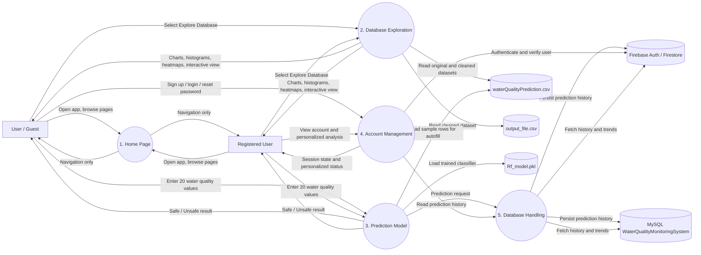

# HydroWatch DFD

## Level 0 Context Diagram

```mermaid
flowchart LR
    U[User / Guest] -->|Water quality parameters, navigation, login/signup| S((HydroWatch Web App))
    R[Registered User] -->|Water quality parameters, account actions, view history| S

    S -->|Prediction result: Safe / Unsafe| U
    S -->|Prediction result, account status, history, analytics| R

    S -->|Authentication requests| F[Firebase Authentication]
    F -->|Token / auth response| S

    S -->|Read training and cleaned data| C[CSV Datasets]
    C -->|Sample rows, EDA data| S

    S -->|Load model for inference| M[Random Forest Model (.pkl)]
    M -->|Predictions| S

    S -->|Store and retrieve prediction history| D[(Firestore or MySQL)]
    D -->|Historical records| S
```

## Level 1 DFD



## Notes

- The app entry point is [app.py](app.py), which routes to the four pages in `components/`.
- Prediction mode uses the trained Random Forest model stored in [Rf_model.pkl](Rf_model.pkl).
- The exploration page reads [waterQualityPrediction.csv](waterQualityPrediction.csv) and [output_file.csv](output_file.csv).
- Registered predictions are written to Firestore when Firebase is configured, otherwise they fall back to MySQL through [components/database_creation.py](components/database_creation.py).
- Guest mode predicts without saving history.
